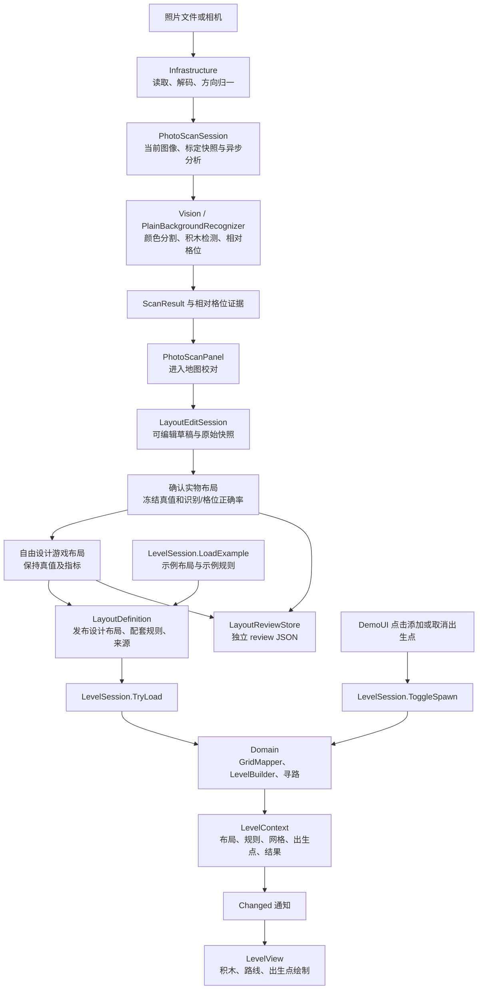

# 项目整体架构

当前实现关卡生成、路线预览与布局挑战战斗：模拟布局或照片识别生成 10×10 实体格，再映射为 20×20 导航格，显示积木并复用路线进行敌人移动和塔自动攻击。
照片在本地处理。战斗支持手动波次、多核心共血、胜负、暂停、重试与返回扫描；默认平衡和 Android 性能仍待试玩与真机验收。

2026-10-09 的重构已完成五个主要模块划分，并通过 `.asmdef` 显式约束引用；公共数据和既有第三方算法另设基础程序集。

## 五个主要模块

| 模块 | 主要文件 | 职责 |
| --- | --- | --- |
| Domain | `Domain/ExampleScans.cs`、`LevelPipeline.cs`、`GridPathfinder.cs`、`BattleSimulation.cs` | 格位映射、结构校验与 A*；纯 C# 固定步长战斗、索敌、伤害、共享核心、波次与胜负。 |
| Vision | `Vision/PlainBackgroundRecognizer.cs`、`PhotoModels.cs` | 图像与背景/积木颜色标定、背景分割、同色组件拆分和相对布局；像素证据与拒绝原因。 |
| Application | `Application/LevelSession.cs`、`PhotoScanSession.cs`、`LayoutEditSession.cs`、`BattleSession.cs` | 异步分析与两阶段草稿校对，编辑撤销、真值冻结、两项正确率；关卡提交、战斗快照、锁定、暂停与重试。 |
| Presentation | `Presentation/BrickDefenseDemo.cs`、`LevelView.cs`、`DemoUI.cs`、`PhotoScanPanel.cs`、`LayoutReviewPanel.cs`、`CombatView.cs`、`BattlePanel.cs` | 场景接线，照片与二维编辑/三维草稿预览；战斗参数、敌人/血条/射击/射程显示及结算；正交相机与输入。 |
| Infrastructure | `Infrastructure/PhotoFileSource.cs`、`CameraCapture.cs`、`PhotoPixels.cs`、`PhotoProfileStore.cs`、`ScanReportStore.cs`、`LayoutReviewStore.cs` | 图像、相机、标定与扫描报告；校对/设计记录和两项统计保存。 |

上述路径以 `Assets/Scripts/` 为起点。Application 的命名空间为 `BrickDefense.Workflow`，避免与 Unity 的 `Application` 类型冲突。
Domain 和公共数据仍使用既有 `BrickDefense.Core` 命名空间；命名空间兼容不影响程序集边界。

界面固定使用简体中文。`SoftStrategyTheme` 为全部文字与输入框加载 `Resources/Fonts/NotoSansSC-Regular.otf`；`ChineseUi` 在 Presentation 按稳定错误代码/已知平台消息翻译显示文字，扫描报告继续保存既有诊断代码与原始信息。字体来源与 OFL 见 `Assets/ThirdParty/NotoSansSC/`，完整许可证也放在 Resources 中随播放器分发。

`BattlePanel` 将开始入口与战斗状态卡片定位到右侧路线状态卡片下方。绘制与指针拦截使用同一个卡片矩形，因此相机和地图选格会避开实际按钮位置；参数表单保留居中弹窗。宽/窄屏与实际输入验证见 [中文界面验证](../.scratch/chinese-ui/verification/README.md)。

## 基础模块与编译边界

| 程序集 | 显式项目引用 | Unity 引用 |
| --- | --- | --- |
| `BrickDefense.Contracts` | 无 | 禁用 |
| `BrickDefense.Algorithms` | Contracts | 禁用 |
| `BrickDefense.Domain` | Contracts、Algorithms | 禁用 |
| `BrickDefense.Vision` | Contracts、Algorithms | 禁用 |
| `BrickDefense.Application` | Contracts、Domain、Vision | 禁用 |
| `BrickDefense.Infrastructure` | Contracts、Vision | 允许 |
| `BrickDefense.Presentation` | Contracts、Application、Vision、Infrastructure | 允许 |
| `BrickDefense.Editor` | Contracts、Domain、Vision、Application、Infrastructure、Presentation | 仅 Editor 平台 |

- `Contracts/Models.cs`、`PhotoEvidence.cs` 与 `CombatModels.cs` 保存结果、证据、不可变战斗配置/状态和射击事件。Domain 可以接收带照片证据的扫描结果，且不引用 Vision 实现。

- 战斗的外部接口集中在 `BattleSession`：启动并验证、推进时间、开始下一波、暂停、重试、返回布局。`BattleSimulation` 接收配置与路线，返回状态和射击事件；射击显示不决定伤害。地图锁定在 `LevelSession` 中执行，照片提交也经过同一锁定检查。首波开始至终局或主动结束期间不更换地图。
- `Assets/ThirdParty/` 的 Algorithms 程序集包含 Roy 最小堆和 Colourful 色彩转换子集。通过 `InternalsVisibleTo` 向 Domain 和 Vision 开放实际需要的内部算法类型；来源及授权见 [第三方声明](../THIRD_PARTY_NOTICES.md)。
- `Assets/Editor/` 的场景生成、编辑器文件选择器和回归工具单独编译。编辑器文件对话框通过回调接入 `PhotoFileSource`；Windows Player 经 Infrastructure 的 `WindowsPhotoFilePicker` 打开原生 Unicode 图片选择窗口。Windows 适配以平台条件编译隔离，运行时程序集不引用 `UnityEditor` 或 Windows Forms。
- `Tests/` 的 .NET 检查编译纯 C# 模块；Unity 显示与平台读写由编辑器 Play 回归覆盖。

引用方向没有环。Domain 不直接读取文件、使用相机、访问 UI 或 Unity 对象；Presentation 经 Application 改变关卡状态。

## 运行流程

`BrickDefenseDemo` 负责创建模块、连接通知与显示、加载初始示例和注销监听。
`LevelView` 只根据已有的 `LevelResult` 绘制；显示拒绝结果时仍保留可预览的实体。
400 个底板格独立于积木绘制，因此只看到底板不能证明关卡生成成功。

## 关卡状态的唯一更新入口

`LevelSession.Current` 保存当前 `LevelContext`。所有示例、照片确认和出生点变更经同一公开接口更新。

- `LoadExample` 同时选择示例布局和 `demo-*` 规则。
- `TryLoad` 接受一个完整的 `LayoutDefinition`，其中包括布局、规则和来源。它复制输入数组及颜色映射，完成映射和校验后一次性替换当前上下文，再发送 `Changed` 通知。
- 不确定扫描、未映射颜色、畸形输入或缺少核心时不替换当前关卡。
- `NO_ROUTE` 和 `SPAWN_OCCUPIED` 保留实体并允许预览；无有效路线时不绘制路线。
- `ToggleSpawn` 添加/删除入口，复用同一份格位与角色网格分别计算 A*；无效新点保留原选择并给出 SpawnSelectionIssue。清空入口仍保留地图，NO_SPAWNS 禁止开局。`SelectSpawn` 保留单点替换语义供旧集成使用。
- `LevelResult.SpawnRoutes` 保存只读的入口与独立路线集合，整体 Status 反映全部入口。单入口兼容字段描述首个入口。`BattleSession` 冻结整个集合；`BattleSimulation` 以累计计数轮流出怪，每只敌人通过 SpawnIndex 绑定其路线，跨波继续轮转。

这个边界解决了之前照片入口更新规则、示例入口只更新网格而出现 `UNMAPPED_COLOR` 的问题。
界面和视图不再分别持有可独立变化的当前网格、规则和路线。

## 照片分析与平台读写

`PhotoScanSession` 保存图像、扫描编号、忙碌状态、耗时和结果。开始分析时复制标定数据；`BeginReview` 允许完整返回的成功或拒绝分析进入人工校对，使用分析时冻结的颜色规则。原 `ConfirmLayout` 仍只接受成功扫描，保留底层自动流程兼容；用户界面统一经两阶段校对发布。
换图或重新标定会使旧结果失效；较早的异步任务返回时，不能覆盖新输入的状态。

照片统一调用 `PlainBackgroundRecognizer`，不再提供模式切换。格纸识别器、标记定位、投影拟合、模板与 ArUco 专用依赖已移除；结果仍使用相同的 `ScanResult` 合同，Domain 和 LevelSession 保持接口。
无格纸没有固定纸面原点，结果标注 `LayoutCoordinateBasis.RelativeBrickScale`，使用图像左上方向与估计边长生成相对离散网格。它不虚构标记或纸张角点，`IsReliable=false` 表示没有定位到真实格纸，逐块测量框仍保存在 ImageEvidence。
低饱和颜色在无格纸模式保留绝对明度，以区别灰背景和白积木；彩色描述继续复用既有 NormalizedLab。相邻组件按尺寸和实际颜色覆盖拆分，L 形中的空区域不会被填满。

照片面板只显示预览和控件，并调用这些接口：

- `PhotoFileSource` 校验 PNG/JPG 类型、32 MB 文件上限和 4096 像素长边上限，返回原文件字节及归一化图像帧。
- `CameraCapture` 管理设备启动、权限、超时、拍摄及停止；面板负责取景预览。
- `PhotoProfileStore` 默认使用已有无格纸键 `BrickDefense.PhotoCalibration.plain.v1` 和四颜色数组格式，已有背景/核心/城墙/塔标定可直接加载；读取 `Resources/photo-scan-settings.json` 的无格纸参数。颜色角色仍由用户采样顺序决定。
- `ScanReportStore` 在 `Application.persistentDataPath/Scans/<scanId>/` 保存原文件、方向归一后的 PNG、标定、设置、结果和耗时。

报告继续记录 `inputMode=PlainBackground`、`coordinateBasis=RelativeBrickScale`、`direction`、`boardIsReliable=false`，保留既有报告字段。预览绘制每个独立对象的测量框；确认后的地图显示为相对布局。`ColorCalibration.Background` 表示背景色，取代旧纸面命名；旧格纸报告留作历史，不再生成。

扫描记录用于诊断，当前未实现完整的关卡存档加载系统。

## 地图校对与评价

`LayoutEditSession` 管理草稿和最近 64 步可撤销修改，移动/改色保留积木 ID，补加表示漏检、删除表示误检。实物确认冻结人工真值并逐块与原始快照比较：识别看检测与颜色，格位看相对行列，分别统计漏检、误检及颜色/位置错误。各布局以 min-column/min-row → 1 的固定约定表示，整体平移不影响相对位置正确率。单次玩家核验不等同独立验收数据集。

`LayoutReviewPanel` 显示原照片与二维草稿，可选中棋盘外/重叠检测进行修正；三维预览调用 `LevelView.DisplayDraft`，不更新 `LevelSession.Current`，不要求核心/道路。返回照片或取消预览恢复当前关卡视图。

实物确认后进入游戏设计，保持统计与真值；重新校对从上次真值开始，需要重新确认。提交建立一致的 100 格合同，经现有 `LevelSession.TryLoad` 发布；核心与战斗可达性仍由 Domain 检查。

`LayoutReviewStore` 保存原始、真值、设计三组快照和阶段操作到独立 review JSON；不覆盖原扫描 result.json，保持原始拒绝诊断。未知/裁切/拆分错误下检测到的可用积木保留，原始状态仍是 Rejected，人工修正不会伪造自动成功。

## 数据合同

1. `ScanResult`：100 个实体格的空/占用/不确定状态，独立积木编号、颜色编号、错误和可选照片证据。同色相邻仍是不同积木。
2. `GridResult`：400 个导航格；每块积木占 2×2 导航格，保留来源编号。
3. `LevelRules`：颜色与核心、墙、塔的对应。照片使用 `physical-color-*`，示例使用 `demo-*`，随输入整体提交。
4. `LevelResult`：实体、角色、出生点、目标核心、路线和拒绝原因。
5. `LayoutDefinition` / `LevelContext`：前者是 Application 接收的完整输入，后者是当前输入与所有计算结果的一组上下文。

## 重构验证

- .NET：既有识别与寻路回归、200 个布局的独立 BFS 对照，以及新增的输入切换、失败保留状态、输入快照、出生点和照片确认检查全部通过。
- Unity 6000.3.24f1：在隔离项目实际编译全部程序集，Play 回归通过；纯逻辑程序集无 Unity 引用，运行时程序集无 UnityEditor 引用。
- 实际渲染：普通示例 9 块、16 步路线；包围示例 5 块、`NO_ROUTE`；照片与两个示例反复切换正常。
- 早期格纸 PNG 实验结果保留在历史检索/验证记录中；当前实际操作检查使用原实拍 JPG 及其归一化 PNG。
- 保留已有场景脚本 GUID 和标定格式，场景更新为新的 Presentation 程序集名称。新增资源的 `.meta` 已核对。
- 无格纸实拍：原 JPG 在纯 C# 和 Unity 默认入口均识别 7 橙/2 蓝/1 白、10 个独立方块，标定恢复、确认与实际界面通过；缩放、颜色角色互换、L 形/2×2 紧贴、未知色、裁切、空背景与旧结果失效回归通过。

硬件相机、Android 构建及实拍准确率尚未验收。本次验证没有改变这些边界。
前置候选比较、适配和结果见 [重构研究记录](research/architecture-refactor-github.md)。
当前唯一照片入口见 [v1.2 规范](requirements-plain-only-v1.2.md)、[裁剪检索](research/plain-only-photo-github.md) 与 [实际验证](../.scratch/plain-only-photo/verification/README.md)；[v1.1](requirements-markerless-v1.1.md) 留作扩展历史。
