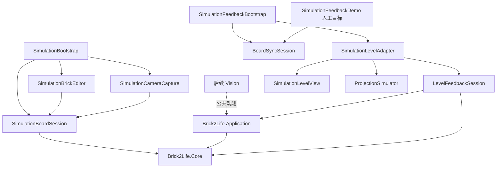

# Brick2Life 架构

更新：2026-10-25。当前实现独立仿真、公共棋盘核心、纯 C# 确认会话，以及任务 C 的关卡反馈与虚拟投影；视觉识别（B）仍是待接入项。

## 模块与依赖

- Core 不引用 Unity 或其他项目模块。Contracts 集中公共类型，BoardLayout 维护可编辑布局，BoardDelta 计算格位变化。
- Application 仅引用 Core。BoardSyncSession 拥有视觉确认状态；方法在同一线程调用，异步 B 的结果由集成入口切回所属线程。
- Application 的 DatasetPlan 定义有限的日常测试布局、稳定种子及逻辑内容分组；它不修改公共棋盘合同。Editor 负责隔离采集任务，Simulation 继续只依赖 Core。
- Application 另含任务 C 的纯逻辑：LevelSemantics（颜色→角色、关卡状态与合法性）、ProjectionPlan（逐格投影标记）、LevelFeedbackSession（消费 BoardUpdate 产出反馈帧）。三者都不引用 Unity。
- Simulation 引用 Core 和 Unity UI，承担引擎具体实现。Bootstrap 组装棋盘、编辑界面与采集。
- Feedback 引用 Core、Application、Simulation 和 Unity UI，是任务 C 的引擎侧：SimulationFeedbackBootstrap 建立 BoardSyncSession，SimulationLevelAdapter 把 BoardUpdate 变成关卡对象与投影标记，SimulationLevelView 生成游戏对象，ProjectionSimulator 生成贴在表面上的投影面片。
- Editor 引用 Core、Application、Simulation、Feedback 和 Unity UI，仅 Editor 编译，承载灯光配置、任务 C 安装与分层检查、依赖检查与构建。
- Vision 随具体实现加入（当前在 `feat/task-b-recognition` 分支），没有引入推理、网络或依赖注入框架。

Awake 顺序为棋盘会话 -200、接线 -100、任务 C 反馈入口 -50，随后编辑界面 Start。已有按钮方法与 MonoBehaviour GUID 保留；原场景的布局、材质和调色板迁入棋盘会话。

Awake 顺序为棋盘会话 -200、接线 -100，随后编辑界面 Start。已有按钮方法与 MonoBehaviour GUID 保留；原场景的布局、材质和调色板迁入棋盘会话。

## 状态归属

| 状态 | 写入者 | 跨模块表达 |
| --- | --- | --- |
| 仿真真实布局 | SimulationBoardSession 中的 BoardLayout | Simulation 来源的冻结快照，供采集/评价 |
| 视觉候选 | B | FrameObservation，允许占用/颜色未知或整体拒绝 |
| 视觉确认布局 | BoardSyncSession | Confirmed 与 BoardUpdate；C 消费此处发布的状态 |
| 关卡状态 | LevelFeedbackSession（Application） | LevelState：逐格占用、颜色与 GameRole，来源版本等于确认快照版本 |
| 投影计划 | ProjectionPlanBuilder（Application） | ProjectionPlan：与引擎无关的格位矩形，Unity 侧只负责变成面片 |

棋盘会话集中执行模型与 GameObject 的增删移动。界面只处理输入和反馈文字。Bricks 是实时只读视图，跨模块必须使用 Snapshot。可以用快照构建新的 BoardLayout，保留已有来源 ID 与版本。

SimulationBoardSession.ReplaceLayout 先校验定义并准备全部几何，再替换整盘模型与视图；恢复快照也递增本地版本，避免版本回退。替换后需要重新读取 Bricks，持有的旧视图不代表新布局；跨模块仍使用 Snapshot。它供自动采集使用，不连接视觉确认状态。

## 公共合同

- BoardDefinition：固定 10×10、单层，棋盘 ID、定义版本、格长/单位和合法颜色。空调色板表示编辑/测试允许任意非空颜色；场景使用有限颜色集合。
- BoardCell：Unknown / Empty / Occupied。Occupied 且 ColorId 为空表示颜色未知。可选 BrickId 仅代表来源身份，不作为视觉匹配依据。
- BoardSnapshot：100 个确定格位、状态版本和来源。复制传入集合，校验完整性、颜色和重复 ID；嵌套格位也不可变。
- FrameObservation：帧 ID、会话、顺序、UTC 时间、标定标识、逐格结果和失败原因。可选置信字段是算法分数，不解释为经校准的正确概率。
- BoardDelta：相同棋盘定义下两个版本的格位变化。只比较占用与颜色；移动表达为源/目标格变化，同色匹配有多种候选时标记歧义，不声称识别了物理实例。

逻辑 X/Y 到 Unity X/Z 的转换属于引擎适配。图像原点在左上，数组为 y*width+x。棋盘定义变化需重新建立可比较基线。定义版本、状态版本、JSON schema、帧顺序和标定标识分别管理。

## B/C 接入

创建 BoardSyncSession(definition, calibrationId)。获取图像后调用 BeginFrame(frameId, capturedAtUtc)，得到 ObservationRequest。B 接收 RGB、公开棋盘/标定和请求关联字段，返回 FrameObservation。Confirm(request, observation) 返回：

| 结果 | 含义 |
| --- | --- |
| Baseline | 首次确认，Delta=null，不假定先前棋盘为空 |
| Changed | 新版本及差异，供 C 更新应用/显示 |
| Unchanged | 保留原快照和版本，差异为空 |
| Rejected | 保留确认状态，返回原因 |
| Stale | 请求已被替代、取消或处理，不影响当前请求 |

Fail 用于采集/识别异常，Cancel 用于取消；ChangeCalibration 取消旧请求并保留旧确认状态供显示。第一阶段只有所有格位占用和颜色都确定才整体确认。应用无路等问题不属于视觉拒绝。

投影清空、等待画面稳定和失败后的显示恢复，在具体 Projection 接入时由实际 Application 流程统一管理；当前纯确认会话尚未控制投影。

### C：关卡与投影（2026-10-25）

任务 C 只消费预测事件：输入固定为 `BoardUpdate`，不读 `SimulationBoardSession.Snapshot()`、不读 GT、不创建观测。

- `LevelSemantics`：`GameRole`（None/Core/Wall/Tower）与 `LevelRuleSet` 显式颜色规则；`LevelState` 保存逐格占用、颜色、角色与来源版本。缺核心、多核心、未映射颜色都记入 `Issues` 且 `IsPlayable=false`。布局非法时仍然发布状态（保留感知结果），由上层推迟关卡提交。
- `ProjectionPlan`：与引擎无关的标记列表。格点是 11×11 交点（落在有积木的相邻格时投到积木顶面，否则投桌面）；角色高亮只覆盖占用格；变更提示来自 `BoardDelta`，区分 Added/Removed/Recolored。`MaxMarks` 截断，输出顺序固定，可复现。
- `LevelFeedbackSession`：Baseline 建立基线且无变更提示；Changed 重建并带变更提示；Unchanged 不推进版本、不刷新视图；Rejected/Stale 保留上一版关卡与投影并给出原因。
- `Brick2Life.Feedback` 程序集：`SimulationFeedbackBootstrap` 用 `board.Definition` 建立 `BoardSyncSession`（标定 `brick2life-simulation`），把它交给 `SimulationLevelAdapter`；Adapter 在 `frame.Changed` 时刷新 `SimulationLevelView`（游戏对象）与 `ProjectionSimulator`（投影面片）。
- 场景分层：`Brick2LifeGame`（30）放游戏对象，顶置相机排除该层，避免虚拟建筑被拍进 RGB；`Brick2LifeProjection`（31）放投影面片，顶置相机包含该层，投影因此进入实验图像；操作相机包含两者并继续排除 UI 层（5）。关闭投影层对象即可得到“投影关”的对照图像。
- 独立演示：`SimulationFeedbackDemo` 按固定样例提交人工目标（界面与日志标注“人工目标（非识别结果）”，F5/F6/F7 切换），依据 `.scratch/task-a-simulation/spec.md` 第 2 阶段，不作为识别已接通的证据。接入 B 后禁用该组件即可。
- 限制：投影是贴在可见表面上的面片（alpha 混合），不是光学投影仿真，没有镜头畸变、亮度衰减与梯形校正；升级为官方 `Projector` 组件时只替换渲染层，不改 Application 层接口。

## 采集与持久化

CaptureFrame() 返回 SimulationCapture 或抛出异常，不写文件，也不依赖编辑界面/状态文字。结果包含独立 PNG 副本、帧信息、冻结 GT 和采集 JSON。整个评价封装不传给 B。

SaveImage 是按钮适配：调用 CaptureFrame 后配对写入 PNG/JSON，JSON 最后发布；保留采集期间布局、目标纹理、相机及灯光变化检查。现有 schema 3/相机 1/光照 2 与角点约定不变。Unity JsonUtility 所需 DTO 留在适配内，公共逻辑类型不依赖它们。

按钮与数据集生成共用 SimulationCaptureWriter，拒绝覆盖并清理本次失败写入。数据集流程为：Editor 设置 → PowerShell 冻结源文件并启动隔离 Unity → DatasetPlan → ReplaceLayout／光照 → CaptureFrame → 配对保存 → 发布清单。默认 100 张，同布局的五种光照共用 layoutGroupId；清单和 GT 用于评测，不能整体传给 B。设置、输出及取消规则见 [测试集生成指南](task-a-dataset-generation-guide.md)。

## 退役与入口

旧系统移入 Archive/BrickDefense，原文件与 SHA-256 在 manifest.json；恢复完整旧工程使用已推送的 b47a6ed。字体、字体授权、uGUI、仿真材质、RenderTexture、用户采集与工作记录保留。

默认场景为 Brick2LifeSimulation，产品名为 Brick2Life。Player 使用当前产品的 persistentDataPath；已有旧产品采集目录不迁移、不删除。

默认 .NET 工程只显式编译 Core、Application 和主线检查，不递归包含 Archive 或 Unity 检查。相机/光照检查脚本复制当前真实依赖到独立工程。

## 验证

2026-10-20 实际执行：

- `dotnet run --project Tests/Brick2Life.Checks.csproj`：369 项断言通过（原布局 325、合同 24、确认会话 20）。
- Unity 相机回归：684 项通过，验证工程为 `.scratch/camera-metadata-validation/run-20261020-150048-231/`。采集 fixture 不创建编辑界面，直接绑定棋盘会话。
- Unity 光照/编辑/采集回归：349 项通过、34 对样本，工程为 `.scratch/lighting-validation/run-20261020-151032-153/`。包含真实场景增删移动、占用拒绝、同帧几何更新、冻结采集、滑块和变化拒绝。
- Windows x64 Development Player 构建成功，输出 `Builds/Brick2Life/Brick2Life.exe`；`Builds/architecture-verification.json` 确认 Core/Application 无 Unity 引用、当前场景无缺失脚本。
- 归档的 178 个文件（含 74 个 .meta）逐项 SHA-256 一致；原场景除状态配置/接线外的记录和字体二进制保持不变。

光照首次恢复检查中，配置/GT 完全一致，9/262144 像素出现最多 1 级通道差异；相同配置的另一张图也有 8 像素单级波动。检查现要求配置完全一致，且画面最多 0.01% 像素、每通道最多差 1；最终回归实际差异为 0。首次并发相机检查因 Package Manager 连接取消退出，串行重跑通过。

构建和隔离场景检查不代表 B/C 已接通，也不代表真实相机精度、实体投影误差或 Android 真机验收。当前主工程已安全退出 Play，运行时的 10 块布局和画面另存于工作区 `.artifact-work/architecture-20261020/`，磁盘场景仍保留原布局。

机制比较与采用范围见 [编码前检索](research/brick2life-core-architecture-github.md)。

随后加入有限自动测试集：纯 C# 检查增加至 390 项，Unity 光照／棋盘／保存回归增加至 359 项并保持 34 对光照样本。已实际生成并检查 100 对 RGB/GT，另验证 Windows 菜单启动方式和中途取消。运行路径、数据检查结果与使用方式见 [测试集生成指南](task-a-dataset-generation-guide.md)。

2026-10-25 任务 C 实际执行：

- `dotnet run --project Tests/Brick2Life.Checks.csproj`：463 项断言通过（新增关卡语义 22、投影计划 25、反馈会话 26；原 390 项不变）。
- 编译基线：用 Unity 2022.3.62f3c1 的模块程序集与 netstandard 2.1 引用、以及内置 uGUI 源码编译出的 `UnityEngine.UI`，逐程序集编译 Core/Application/Simulation/Feedback/Editor，全部通过。这是语法与 API 基线，不替代 Unity 6000.3.24f1 的实际编译。
- 未执行（本机无 Unity 6.3）：在真实编辑器中运行场景、面片与格位对齐的实测、投影开/关的顶置相机图像对照、分层掩码的运行时复核、Windows Player 构建。执行方式与核对点见 [任务 C 反馈指南](task-c-feedback-guide.md)。
