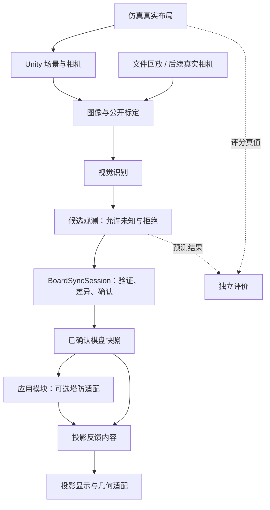

# Brick2Life 当前架构评议与优化建议

> 历史核对记录。2026-10-20 已实施旧系统退役与 Core/Application 重构；当前目录和状态以 [架构说明](architecture.md) 为准。

日期：2026-10-20。评议对象：当前磁盘中的 Brick2Life 工程，包含未提交修改；已提交基线为 `597c47b`。按用户最新说明，Brick2Life 是唯一开发主线，BrickDefense 已退役。用户进一步指出旧系统残留过多后，本评议将整体归档旧系统调整为首要建议，不再默认维持旧系统的运行和编译。

## 1. 总体判断

当前架构适合继续完成单层仿真与按需采集原型，已经具备良好的状态模型和数据一致性保护。它尚未形成覆盖“图像输入、视觉预测、状态确认、变化检测、应用反馈”的 Brick2Life 系统架构。

主要风险集中在模块之间的数据语义和控制关系：仿真布局、采集 JSON、旧识别结果、旧关卡状态分别成立，但还没有统一的固定棋盘状态及确认流程。继续增加功能前，应先解决这些连接处。

建议先清退旧系统，再对 Brick2Life 做渐进式模块化：保留当前仿真工作台，将旧代码、旧场景和旧检查整体移出活动工程；随后提取公共状态和确认流程，再接识别、投影与应用模块。旧算法只作为历史参考，出现实际需求时单独迁入，不因“可能复用”继续保留整套旧架构。

### 补充核对：旧系统可以整体退役

本次读取 Simulation 全部源码，并从 Brick2LifeSimulation 场景沿本地资源 GUID 递归核对引用：

- 当前新主线有 9 个运行时脚本，源码中没有旧 BrickDefense 命名空间引用。
- 活动目录仍有 33 个旧运行时脚本，以及 9 个旧编辑器脚本；这些计数不包含旧第三方算法源码。
- 仿真场景的本地资源引用未指向旧运行时脚本；实际使用仿真材质、TopCameraRGB、中文字体和新仿真脚本。纯 C# 布局与光照快照通过新脚本的源码依赖参与运行，不以场景组件的形式直接出现。
- 编译上的混合点是 BrickDefense.Editor.asmdef：旧编辑器程序集同时引用旧模块和 Brick2Life.Simulation，新的 SimulationLightingSetup 又位于它的目录内。
- 构建入口仍为旧场景，主测试工程仍编译旧系统，主文档仍以旧流程占主要篇幅。

以上支持“整体归档旧系统”的建议，不构成已经完成清理或 Unity 构建验收的声明。具体归档清单见 [旧系统清退范围](brickdefense-retirement-scope-2026-10-20.md)。

## 2. 当前架构实际是什么

| 部分 | 实际状态 | 评价 |
| --- | --- | --- |
| Brick2Life.Simulation | 一个引用 Unity UI 的程序集，包含布局模型、鼠标编辑、场景绘制、相机采集、光照和文件导出 | 对外独立于旧模块，便于过渡；内部多种职责尚共用编译单元 |
| SimulationLayout | 无 Unity 引用的 C# 类；负责单层占用、不可变积木记录、移动保留 ID、版本递增 | 值得保留并发展为新主线的布局核心 |
| SimulationBrickEditor | 拥有 SimulationLayout，同时处理输入、按钮、GameObject 创建与位置更新 | 当前交互可用；状态所有权依赖界面，增加加载、回放或其他控制入口时成本上升 |
| SimulationCameraCapture | 直接依赖编辑器，读取布局，渲染相机，检查配置，组装私有 JSON 数据结构，写盘并显示状态 | 单次采集保护较完整；后续识别接入和程序化调用需要更清晰的接口 |
| 旧 BrickDefense | Contracts、Domain、Vision、Application、Infrastructure、Presentation 等程序集依赖单向，纯逻辑与 Unity 分开 | 整体退役；具体算法以后按实际需求单独迁入，不作为新平台公共核心 |
| 运行入口与文档 | Build Settings 仍启用旧场景；architecture.md 主要说明旧系统；开发计划与任务规格的部分进度已过时 | 新主线在运行、文档和代码结构中尚未完全对齐 |

新仿真没有引用旧 Application/Vision/Domain。这意味着“旧系统五层划分完成”不能证明 Brick2Life 的识别与反馈链路已经建立，也不应把当前状态描述成两个流程已联通。

## 3. 值得保留的设计

1. **布局独立于照片和游戏角色。** SimulationLayout 不携带照片证据、识别置信度或核心/墙/塔角色，方向正确。
2. **逻辑约束集中在状态模型。** 边界、占用和版本由模型维护；移动产生新的只读积木记录，保留原 ID。
3. **操作相机与实验相机分离。** 工作台视角与采集画面分别负责交互和实验输入，后续应继续维持这一关系。
4. **采集重视一致性。** 同一帧关联时间、布局版本、相机和光照配置；渲染后复查变化，临时文件写入后最后发布 JSON。这些机制应在重构时原样保留。
5. **旧系统已有可借鉴的提交语义。** LevelSession 先计算后替换 Current，PhotoScanSession 使用 revision 防止旧任务覆盖新输入，BattleSession 使用独立快照。可借鉴这些做法，不必把旧照片页面和战斗会话一起移入新核心。

## 4. 优先级最高的架构问题

### 4.1 缺少跨模块通用的棋盘状态

**依据：** SimulationLayout 只提供当前 Bricks 和 Version；导出的 GroundTruth、GroundTruthCell 等类型定义在 SimulationCameraCapture 内部，且使用 Unity 类型。旧共享合同则围绕 ScanResult、照片证据、导航格和塔防角色组织。

**影响：** B/C 独立实现时容易各自定义格位、空格、颜色、版本和坐标，集成阶段才发现字段相同而含义不同。JSON 只能帮助交换文件，不能替代运行时公共合同。

**建议：** 优先定义无 Unity 引用、数量有限的公共数据类型：

| 类型 | 必须表达的含义 |
| --- | --- |
| BoardDefinition | 棋盘 ID、尺寸、格长和单位、固定原点与轴方向；第一阶段仍为 10×10 单层 |
| BoardSnapshot | 一份不可变的已确定布局、棋盘 ID 和状态版本；不要求包含任何游戏角色 |
| FrameObservation | frameId、采集会话/顺序、标定版本、逐格预测、未知状态及失败原因 |
| BoardDelta | 两个确认版本间的格位/颜色差异及匹配歧义 |

仿真 GT 和视觉观测可以共享坐标等基础类型，但必须保留来源和确定性差异。不要用一个含很多可选字段的大类型同时表示 GT、视觉候选、人工确认和游戏结果。

SimulationLayout.Bricks 是只读的实时集合，集合内容仍会随操作改变；它不是被冻结的快照。应提供显式 Snapshot 操作，在跨模块传递时冻结内容和版本。

### 4.2 旧识别接口与新主线存在实质语义冲突

**依据：** PlainBackgroundRecognizer.CalibrationValid 要求恰好三种颜色；ColorCalibration.CreateRules 根据颜色数组顺序生成核心、墙、塔。旧识别格位按最左/最上检测对象归一化，brickId 也由行列生成。新场景当前配置红绿蓝黄四种颜色，布局使用固定世界原点，颜色不绑定角色。

**影响：** 新 RGB 直接交给旧识别流程时，既有颜色数量限制，也有坐标漂移和身份含义问题。移走最左侧的一块积木可能改变其他积木的相对格位；按格位生成的 ID 也不能直接用于跨帧移动判断。

**建议：**

- B 对外输出固定棋盘坐标的观测，颜色分类接受可配置颜色集合。
- 游戏适配模块单独解释 colorId 与玩法角色，不让视觉标定生成游戏规则。
- 旧颜色转换、分割、连通区域等实现可经比较后局部复用；保持旧入口冻结。
- 同色积木的身份没有充分视觉证据时，输出格位差异或歧义；不能把仿真 GUID 当成视觉跟踪答案。

### 4.3 布局状态由界面拥有，采集依赖界面

**依据：** SimulationBrickEditor 内部创建并持有 SimulationLayout；SimulationCameraCapture 经 brickEditor.Bricks 和 LayoutVersion 读取真实状态。初始布局又由场景中积木的位置与材质反向建立。

**影响：** 布局加载、回放、自动检查等后续调用者需要经过界面，或复制其状态同步逻辑。模型与 GameObject 的同步只存在于鼠标操作路径中。

**建议：** 让独立布局会话拥有模型；编辑器提交增删移动操作，绘制模块据状态更新 GameObject，采集模块读取快照。先移动状态所有权和统一提交入口，再按实际修改频率拆分绘制与输入，无需一次拆出大量小类。

### 4.4 缺少新主线的候选验证与确认流程

**依据：** 旧 PhotoScanSession/LevelSession 有局部异步失效与原子替换机制，但新 Simulation 没有连接视觉观测、确认布局和投影反馈的会话。

**影响：** 未来识别失败可能误删积木，较旧结果可能覆盖新结果，投影恢复时机可能散落在按钮和协程中。现阶段这些是待设计的集成风险，不是已经复现的运行故障。

**建议：** 增加一个职责集中的 BoardSyncSession，负责按需更新：

`准备 → 采集 → 分析 → 验证候选 → 确认并发布 → 显示反馈`

- 用 frameId、会话内顺序和 calibrationId 关联输入，拒绝过期结果。
- 候选与 ConfirmedBoard 分开；采集或识别失败时保留上次已确认状态。
- 差异基于前后确认版本计算；无变化时不发布伪变化。
- 投影暂时清空与恢复由同一流程管理，失败/取消时也执行恢复。
- 将物理布局是否可靠与玩法布局是否可用分开。例如墙封路是真实有效的布局变化，游戏模块应报告无路，而不是把它当作视觉识别失败。
- 若仍使用塔防，第一阶段沿用开局快照，局中改图单独设计。

## 5. 随后处理的结构问题

### 5.1 将采集能力从按钮动作中提取

SaveImage 返回 void，并将异常转成 UI 文本与日志；LastSavedPath 表达的是最后一次成功保存的位置。程序化调用者缺少明确的本次成功/失败结果。

建议让采集操作返回带 frameId、图像数据、布局版本和配置的结果，失败返回结构化原因；按钮仅显示结果。文件持久化独立接收已完成的采集结果，继续保留现有配对发布和清理机制。当前单次手动流程可以保持同步；只有测得采集读回或写盘造成明显停顿后，再引入异步优化。

### 5.2 集中坐标约定

当前尺寸和坐标计算分别出现在 SimulationLayout、GridView、WorkspaceCamera、GridPointer、BrickEditor 和 Capture 中，包含 10、0.5、世界 Y=0 等字面值。

建议由 BoardDefinition 提供事实，由 Unity 适配模块集中处理格位到世界坐标、鼠标到棋盘坐标、世界到图像坐标。后续相机到棋盘、棋盘到投影使用有版本的标定数据，明确像素原点、单位及适用高度。桌面与积木顶面需要分别约定，不能只写一个含糊的“坐标转换”。当前仍只实现单层，暂不加入完整三维占用模型。

### 5.3 为联合仿真明确光照控制范围

SimulationLightingSettings 已保存/恢复原环境和质量配置，值得保留；但其修改的是全局 RenderSettings/QualitySettings，SimulationLightingConfiguration.SnapshotScene 又收集所有已加载场景中的灯。

单实验场景下可接受。识别实验与投影仿真合并或多场景加载时，应由一个实验上下文拥有全局设置，明确哪些灯参与采集、哪些属于显示/投影。配置 ID 当前代表记录内容，不保证整个渲染条件可精确重现；需要复现实验时，再补场景、材质及处理流程版本等必要信息。

### 5.4 建立针对主线的默认验证入口

当前 Tests/Program.cs 只有传入 `--simulation-layout-checks` 才运行 SimulationLayoutChecks；默认“全部通过”不包含这 325 项布局检查。项目通过直接编译源文件运行 .NET 检查，也不能单独证明 Unity 程序集依赖和场景接线正确。

建议先建立一个会执行 Brick2Life 核心检查的统一入口，并保留两类验证：纯 C# 验证布局、差异、确认/拒绝和回放；Unity 验证真实相机、渲染、场景引用和导出。优先覆盖未知不等于空、失败保留确认版本、旧帧拒绝、空变化、相同颜色歧义与投影恢复。无需为每个按钮增加镜像式测试。

## 6. 建议的目标数据流



识别只能接收图像与约定公开配置。编辑动作、真实坐标与仿真实例 ID 不进入识别输入。投影仿真的渲染实现可以使用真实场景几何生成表面效果和遮挡；用于决定应用与反馈内容的状态仍应来自视觉确认结果。独立 C 测试可使用明确标记的人工目标，不将其记为识别闭环通过。

初步目录可按下列职责组织；不要求每一项立即新增程序集：

```text
Brick2Life.Core          固定棋盘、不可变快照、合法操作、差异
Brick2Life.Application   候选验证、确认会话、失败恢复
Brick2Life.Vision        RGB 到观测
Brick2Life.Simulation    仿真场景、编辑交互、实验相机和光照
Brick2Life.Projection    反馈显示、投影几何适配
Brick2Life.Infrastructure 文件、配置和设备读写（按实际需要提取）
```

先把纯 C# Core 从 Simulation 编译单元分离。只有形成实际依赖约束或多种实现时，再增加其他程序集和接口。若后续 Brick2Life 应用确实需要某个旧算法，应单独审查并迁入该算法与必要数据类型。新核心不依赖旧页面、示例布局或战斗规则，也不为尚未确定的复用保留旧程序集。

## 7. 建议实施顺序与完成标准

| 顺序 | 交付 | 完成标准 |
| --- | --- | --- |
| 1：旧系统清退 | 归档旧运行时、编辑器、场景、第三方算法、测试和专属资源；拆出独立 Brick2Life 编辑器程序集与测试入口 | 活动编译、默认检查和运行入口仅包含 Brick2Life；字体及授权等真实依赖保留；Unity 编译及新场景独立构建通过 |
| 1b：主线对齐 | 主 README 和架构说明专门描述 Brick2Life；旧需求与研究记录进入历史文档范围 | 新成员能直接运行现有仿真，默认场景为 Brick2LifeSimulation，历史资料不再充当当前规格 |
| 2：公共状态 | BoardDefinition、不可变快照及独立布局会话 | 现有编辑行为保持，采集不再经编辑界面取状态；快照支持保存/恢复 |
| 3：识别合同 | 固定格位、可配置颜色、未知/拒绝与帧/标定版本 | B 可以仅凭 RGB 和公开标定输出预测；评价端单独读取 GT |
| 4：确认与差异 | BoardSyncSession 和小规模固定回放用例 | 无变化稳定；增删移动可验证；未知、旧帧和失败不会破坏确认状态 |
| 5：投影与应用 | 先独立验证投影，再让确认状态驱动反馈；按需适配旧算法 | 单层闭环可重复运行，并记录失败恢复及各阶段耗时 |
| 6：后续扩展 | 多层、历史推断、连续更新和硬件 | 在单层链路稳定后分别设计与验收 |

大规模测试集方案已按用户要求撤回，见 task-a-benchmark-plan.md 的当前状态。本建议不恢复该方案，也不以大规模数据生成为前置条件。先使用少量可解释的固定样例验证模块合同与状态变化。

旧系统整体放到 Unity 导入目录之外的独立历史包或归档目录，不在 Assets 内建立仍会参与编译的 Legacy 文件夹。保存当前磁盘版本、未提交修改和 .meta 配对，不能只依赖旧标签恢复。新主线采用独立的 Brick2Life 编辑器和测试命名；本轮不为清理而重写现有仿真功能。

## 8. 本次验证与结论边界

本次实际执行并通过：

- `dotnet run --no-restore --project Tests/BrickDefense.Checks.csproj -- --simulation-layout-checks`：325 项断言通过。
- `dotnet run --no-build --no-restore --project Tests/BrickDefense.Checks.csproj`：现有识别、校对、流程、战斗、多出生点及 200 个布局的独立 BFS 对照通过。

读取的既有 Unity 记录包括：相机元数据检查 684 项通过；最新光照检查 334 项通过、34 对采集文件。本次没有重新运行 Unity、构建 Player 或操作硬件，既有记录不能代替本次场景验收，也不代表 B/C 的识别精度或投影误差已通过。

本次仅新增评议文档，没有修改运行时代码、场景、构建设置或用户原有未提交文件。

## 9. 关键证据位置

- `Assets/Scripts/Simulation/SimulationLayout.cs:24`：实时只读集合与版本；`:38`：布局操作。
- `Assets/Scripts/Simulation/SimulationBrickEditor.cs:30`、`:58`：界面拥有和创建布局；`:59`：从场景建立初始状态。
- `Assets/Scripts/Simulation/SimulationCameraCapture.cs:17`、`:22`：依赖编辑器及按钮入口；`:31`：采集一致性；`:166`：配对发布；`:198`：私有导出类型。
- `Assets/Scripts/Simulation/Brick2Life.Simulation.asmdef:2`：当前独立编译单元及引用。
- `Assets/Scripts/Vision/PlainBackgroundRecognizer.cs:12`、`:104`：三颜色约束与相对原点；`PhotoModels.cs:72`：角色映射。
- `Assets/Scripts/Contracts/PhotoEvidence.cs:19`：旧合同只有相对积木尺度坐标。
- `Assets/Scripts/Application/LevelSession.cs:53`、`PhotoScanSession.cs:35`：可借鉴的提交与异步失效机制。
- `Assets/Scripts/Simulation/SimulationLightingSettings.cs:86`：全局设置；`SimulationLightingConfiguration.cs:44`：跨已加载场景收集灯。
- `ProjectSettings/EditorBuildSettings.asset:8`：默认旧场景；`Assets/Scenes/Brick2LifeSimulation.unity:3072`：当前实验相机为 Perspective、FOV 50。
- `Tests/Program.cs:2`、`Tests/BrickDefense.Checks.csproj:17`：仿真专项入口及源文件编译方式。
- `docs/brick2life-development-plan.md`、`.scratch/task-a-simulation/spec.md`：目标与分阶段约定；当前进度应结合源码核对。
