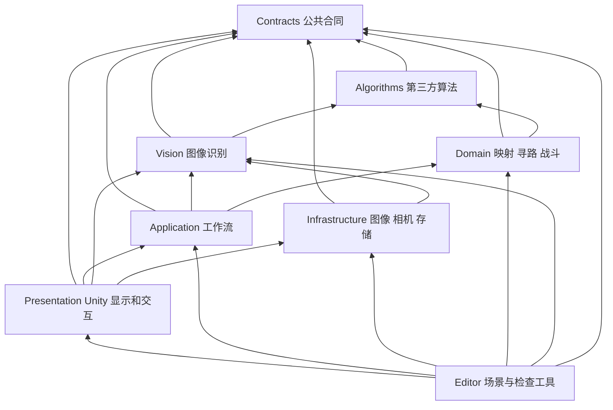
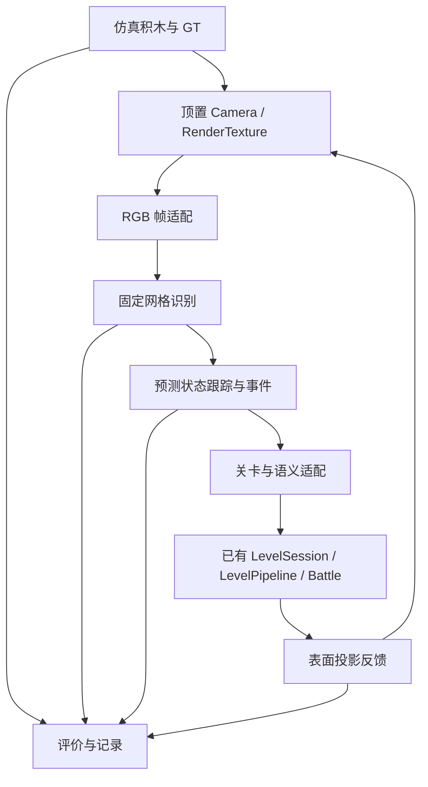

# Brick2Life 方向调整后的 Assets 模块梳理

日期：2026-10-15。

**建议保留现有塔防核心，在同一工程增加独立的仿真场景和感知链路。当前没有必须立即删除的运行时文件；先整理模块接入方式，再处理少量旧工具。**

本次将主工程全部 63 个非 `.meta` 文件分为四类。分类表示未来处理建议，尚未执行删除或运行时代码修改。

| 分类 | 文件数 | 处理原则 |
| --- | ---: | --- |
| 直接复用 | 27 | 保持当前实现或资源，通过新入口继续使用。 |
| 需要修改 | 9 | 修改职责或增加适配；其中旧识别器保留为基线，固定网格识别另建。 |
| 可以删除 | 3 | 旧 UI 专用检查工具，满足归档与替代覆盖条件后可删；本轮不执行。 |
| 暂时保留 | 24 | 支撑旧 Demo、照片基线、回归和调试，暂不接入新主流程。 |
| 合计 | 63 | 另有 78 个资源/目录 `.meta`，合计 141 个文件。 |

## 1 梳理依据和版本范围

### 新方向

依据用户提供的 [任务说明书](D:/桌面/fengong.docx) 和 [研究指南](D:/下载/Brick2Life_Research_Guide.docx)，本阶段的目标是：

**虚拟积木编辑 → 顶置虚拟相机 RGB → 固定格点识别 → 变化跟踪 → 已有塔防更新 → 虚拟投影反馈。**

- 当前只做 Unity 仿真；固定 10×10、单层、等大积木。
- GT、预测状态、游戏状态相互区分。感知不能读取积木 Transform、编辑器操作或 GT 来代替图像识别。
- 投影需要作用于积木/桌面的可见表面，并进入下一帧相机 RGB；屏幕 UI 叠图不满足这一目标。
- 首期在建造阶段提交布局；保留现有战斗快照锁定，不增加战斗中任意改图。
- 使用实际运行的数据评价占用、颜色、事件、延迟及投影对齐。

分享链接未能读取，用户随后上传的研究指南补充了对话方向。本报告不把链接未读取的内容当作已核实事实。旧的 2026-10-14 硬件草案，以及 task-a 工作区中的过渡计划，部分仍描述真实设备与按需采集；后续实施应以这次两份文档的纯仿真方向为准。

### 实际检查的工程

| 位置 | 状态和本次处理 |
| --- | --- |
| `D:/桌面/计算机图形学/BrickDefenseMVP` | 主审计工程，`main` 的 HEAD 为 `c3bce83daacb4ac3b09434ce96a748c983d55abf`；开始检查时工作区干净。 |
| `D:/桌面/计算机图形学/work/task-a-unity-bricks-camera` | HEAD 为 `c1d2d53`，比上述基线增加过渡文档提交；`git diff c3bce83 c1d2d53 -- Assets` 无差异，尚无任务 A 仿真实现。 |
| `D:/桌面/计算机图形学/work/experiment-records` | 独立分支上有未提交的实验记录/CSV/目录打开改动；不在当前主工程 Assets 中，单列于第 6 节，不能遗漏或直接覆盖。 |

主工程为 Unity `6000.3.24f1`、Built-in 渲染管线。当前构建入口只有 `Assets/Scenes/BrickDefenseDemo.unity`。Assets 约 8.31 MiB，其中中文字体约 7.95 MiB；没有大量模型、贴图、Prefab 或投影 Shader 可供清理。

方法是源码、程序集、序列化 GUID、字符串资源加载和历史发布修复记录的静态核对。本次未启动 Unity、运行回归或测量新的识别性能，下面不把“可复用”写成“新方向已验收”。

## 2 当前模块和真实调用关系

### 程序集关系

当前有 8 个 `.asmdef`，其划分可以沿用。



Contracts、Algorithms、Domain、Vision、Application 设置了 `noEngineReferences=true`，没有 Unity 引用。不要为了仿真而把 Camera、GameObject 或 GT 仿真对象塞进识别与游戏规则程序集。

### 当前运行链路

```text
BrickDefenseDemo.Start
  ├─ 创建 LevelSession、LevelView、BattleSession、CombatView
  ├─ 创建 PhotoScanPanel、LayoutReviewPanel、BattlePanel、DemoUI
  └─ LevelSession.LoadExample → ExampleScans → 关卡预览

照片文件 / WebCamTexture
  → PhotoFileSource / CameraCapture
  → PhotoPixels → ImageFrame
  → PhotoScanSession → PlainBackgroundRecognizer
  → ScanResult（相对坐标）
  → LayoutEditSession / LayoutReviewPanel（人工校对与设计）
  → LevelSession.TryLoad
  → GridMapper → LevelBuilder → GridPathfinder
  → LevelView.Display
  → BattleSession → BattleSimulation → CombatView
```

场景 YAML 只直接挂载 `BrickDefenseDemo`。其余大量模块通过 `AddComponent` 和普通 C# 调用在运行时接入，因此“场景里搜不到脚本 GUID”不代表脚本无用。

## 3 四类文件清单

以下路径相对于 `Assets/`。每个非 `.meta` 文件只计入一类；资源对应 `.meta` 继承同样处理方式。

### 3.1 直接复用 27 个文件

| 文件或组 | 当前作用 | 新方向中的用法与边界 |
| --- | --- | --- |
| `Scripts/Contracts/CombatModels.cs` | 波次、战斗配置、敌人、射击和结算状态 | 继续作为塔防数据合同。 |
| `Scripts/Domain/LevelPipeline.cs` | 100 个实体格校验、1:4 导航映射、颜色角色映射、核心与路线检查 | 由新的预测布局适配器调用；核心缺失等游戏错误不应阻止感知状态保存。 |
| `Scripts/Domain/GridPathfinder.cs` | 20×20 导航格上的 A*、核心选择 | 建造阶段布局确认后重新计算，不重写寻路。 |
| `Scripts/Domain/BattleSimulation.cs` | 波次、敌人移动、塔攻击、核心生命与胜负 | 保持原战斗逻辑，首期不做对局中热更新。 |
| `Scripts/Application/BattleSession.cs` | 战斗快照、开始/暂停/重试、布局锁定 | 继续管理战斗生命周期。 |
| `Scripts/Infrastructure/PhotoPixels.cs` | Unity 像素与顶部起始 RGB 数据之间的转换、预览转换 | 虚拟相机读回的像素可经过此入口转换；采集帧号、捕获时刻需由新采集模块关联，不能用转换完成时间替代端到端起点。 |
| `Scripts/Presentation/SoftStrategyTheme.cs` | 中文 IMGUI 字体、颜色和控件样式 | 沿用作为调试界面基础，不把主题颜色当作 GT 或真实积木颜色。 |
| `Scripts/Presentation/ChineseUi.cs` | 现有界面的中文说明与错误文字 | 现有文案继续使用；新增仿真消息按需补充。 |
| `ThirdParty/RoyTAStar/MinHeap.cs` | A* 优先队列 | 保留在用实现及原授权。 |
| `ThirdParty/Colourful/NormalizedLab.cs` | sRGB/D65 Lab 子集、颜色距离 | 可供颜色基线复用；它不能自动抵消投影造成的颜色改变。 |
| `ThirdParty/AssemblyInfo.cs` | 对 Domain、Vision 开放算法内部类型 | 不能独立删掉，否则现有内部类型访问会失效。 |
| 8 个 `.asmdef` | Contracts、Domain、Vision、Application、Infrastructure、Presentation、Algorithms、Editor 的编译边界 | 保留现有边界；新增仿真/投影依赖再局部扩展，不合并成一个大程序集。 |
| `Resources/BrickSurface.mat` | 持久引用 Standard 着色器 | 保留。见第 4 节，不能因没有 `Resources.Load` 调用而删。 |
| `Resources/Fonts/NotoSansSC-Regular.otf`、`NotoSansSC-OFL.txt` | 中文显示和随包字体授权 | 保留，两者共 2 个文件。 |
| `ThirdParty/Colourful/LICENSE.txt`；`ThirdParty/RoyTAStar/LICENSE.txt`、`UPSTREAM-LICENSE.txt`；`ThirdParty/NotoSansSC/OFL.txt`、`SOURCE.md` | 已采用代码及字体的授权、上游来源 | 5 个文件均随所属依赖保留；重复出现的许可证并非普通重复素材。 |

这里的“直接复用”表示不必重写算法或资源。所有运行能力仍需要新场景接线和输入适配。

### 3.2 需要修改或新增适配 9 个文件

| 文件 | 检查到的限制 | 建议处理 |
| --- | --- | --- |
| `Scripts/Contracts/Models.cs` | 同时包含通用格位、识别合同和塔防角色；尚无持续帧、GT/预测来源、变化事件合同 | 保持旧类型兼容，在 Contracts 新文件中增加固定棋盘、预测快照与事件数据，减少直接改动旧游戏类型。100 个感知格与 400 个导航格保持区分。 |
| `Scripts/Contracts/PhotoEvidence.cs` | 坐标依据枚举只有 `RelativeBrickScale`，方向说明也固定为相对照片 | 增加固定棋盘标定依据与版本/标识，保留旧报告兼容；不能只把 `IsReliable` 改成 true。 |
| `Scripts/Vision/PhotoModels.cs` | `ImageFrame` 可用，但 `ColorCalibration.CreateRules()` 按三种采样顺序直接生成核心/墙/塔映射 | 复用 RGB 帧，分离感知颜色配置与游戏语义；游戏规则交给新关卡适配模块。 |
| `Scripts/Vision/PlainBackgroundRecognizer.cs` | 按最左/最上检测中心确定原点并推算块尺寸；需要可估尺寸的独立方块；无积木时返回拒绝 | **旧实现保留作照片/单帧基线，新增 `FixedGridRecognizer`。** 新主线按固定棋盘区域逐格识别，空棋盘是合法感知状态，不能随积木增删移动原点。这是识别模块需要适配，不是要求覆盖此旧文件。 |
| `Scripts/Application/LevelSession.cs` | 来源枚举只有两个示例和照片；`TryLoad` 默认出生点 `(1,18)`；提交要求有核心，允许部分无路布局预览 | 以 `SimulationLevelAdapter` 对接预测状态和语义映射，明确仿真来源与出生点策略；保留“先计算后替换”和战斗锁定。不能将预测失败、游戏未就绪和路线预览混成一个状态。 |
| `Scripts/Infrastructure/ScanReportStore.cs` | 主工程记录照片、识别、颜色与单次处理耗时；不含仿真 GT/预测序列和反馈时刻 | 先处理独立实验记录工作，再扩展 frameId、种子、固定标定、GT/预测快照、事件、操作/采集/确认/投影时刻。不要再开发一套互不关联的 CSV 存储。 |
| `Scripts/Presentation/LevelView.cs` | `Awake` 取得 `Camera.main`，强制正交环绕控制、创建光源并修改全局环境光；按游戏角色重新着色；每次全量重建实体与路线 | 保留关卡绘制能力，分离相机、光照和棋盘搭建职责；注入独立观察相机/显示根与可见层。不能直接充当 GT 积木桌面或投影模块。首期允许确认后全量重建。 |
| `Scripts/Presentation/CombatView.cs` | 按现有关卡世界坐标绘制敌人、射程和射击，没有仿真感知隔离 | 沿用表现与战斗输入，适配统一坐标和 GameFeedback 层；这些虚拟对象默认不进入感知相机。需要研究的投影效果走单独的表面着色路径。 |
| `Editor/DemoSceneSetup.cs` | `CreateDemoScene` 会把 `EditorBuildSettings.scenes` 整体替换成旧场景 | 新场景出现前修正此副作用，生成旧场景时保留其他构建入口；否则菜单可能将新场景从构建列表移除。 |

优先级：固定坐标/状态合同 → RGB 采集与状态隔离 → 固定格点识别 → 关卡适配 → 视图与投影 → 实验扩展。不是按目录顺序逐个重写。

### 3.3 可以删除的条件候选 3 个文件

这 3 个均位于 Editor 程序集，是旧界面验收入口。Assets 内未发现它们的外部 C# 类型调用或序列化 GUID 引用；但历史验证 Markdown 仍记录其执行命令。**没有运行时依赖并不等于现在删掉没有成本。**

| 文件 | 原用途 | 允许清理的条件 |
| --- | --- | --- |
| `Editor/PhotoOverlayChecks.cs` | 重放旧照片面板，检查页面遮挡与截图间隙 | 不再维护该旧页面的布局验收，且归档已有截图/结果，更新检查入口说明。 |
| `Editor/SoftStrategyUiChecks.cs` | 旧柔和策略 UI、照片取色与窄屏流程检查 | 仿真调试界面的新检查已覆盖需要保留的输入/显示路径；旧照片基线仍有单帧与端到端回归。 |
| `Editor/OrbitCameraChecks.cs` | 旧环绕相机、缩放、鼠标/触控回归 | 团队确认暂停维护旧交互行为，或新调试观察相机已有等价检查；不能连带删去仍被 `LevelView` 使用的 `BoardOrbitCamera.cs`。 |

若选择一直维护旧 Demo 的交互回归，这三项继续保留；不必为了凑齐“清理”而删除。当前建议删除数量为 **0**。之后清理这三项时，每个脚本与其 `.meta` 一起处理，最多 6 个物理文件；不删除 Editor 目录及其 `.asmdef`。

### 3.4 暂时保留 24 个文件

| 文件或组 | 数量 | 保留原因与后续定位 |
| --- | ---: | --- |
| `Scenes/BrickDefenseDemo.unity` | 1 | 保留可回归旧入口；独立新增 `Brick2LifeSimulation.unity`，不在原场景上混入全部新功能。 |
| `Scripts/Presentation/BrickDefenseDemo.cs`、`DemoUI.cs` | 2 | 旧场景装配和菜单/输入。新的仿真入口不继承其“先加载示例→照片→人工确认”流程。 |
| `Scripts/Domain/ExampleScans.cs` | 1 | 旧场景启动与关卡测试仍调用；是回归样例，不是仿真相机生成的数据，也不能作为识别预测。 |
| `Scripts/Application/PhotoScanSession.cs` | 1 | 保留照片基线和异步结果失效保护；新增连续感知 Session，不把每帧硬塞进人工扫描确认流程。 |
| `Scripts/Application/LayoutEditSession.cs` | 1 | 可参考增删移动、撤销逻辑；但它要求三角色、非空草稿、人工确认，评价还会归一化整体平移，不适合作为固定仿真 GT。 |
| `Scripts/Contracts/LayoutReviewModels.cs`、`Scripts/Infrastructure/LayoutReviewStore.cs`、`Scripts/Presentation/LayoutReviewPanel.cs` | 3 | 原照片人工校对合同、存储和界面；保留调试/复核，不拿玩家修正后的布局代替自动预测。 |
| `Scripts/Presentation/PhotoScanPanel.cs` | 1 | 旧照片工作流入口，包含设备拍摄、取色和校对；新主流程不要求用户逐帧点击分析。 |
| `Scripts/Infrastructure/CameraCapture.cs` | 1 | 这是 `WebCamTexture` 和设备权限逻辑，不是 Unity `Camera`。暂存为未来真实设备输入，不作为虚拟相机实现。 |
| `Scripts/Infrastructure/PhotoFileSource.cs`、`WindowsPhotoFilePicker.cs`、`Editor/PhotoFilePicker.cs` | 3 | 离线照片/导出帧回放和旧版本仍有用途；导入不属于连续仿真主链。 |
| `Scripts/Infrastructure/PhotoProfileStore.cs`、`Resources/photo-scan-settings.json` | 2 | 保留旧颜色采样键及参数；新仿真设置独立保存，避免覆盖旧照片标定。 |
| `Scripts/Presentation/BoardOrbitCamera.cs` | 1 | 可继续用于用户观察相机；固定顶置采集 Camera 不能受其旋转、缩放或每帧 `Apply` 控制。 |
| `Scripts/Presentation/BoardTouchControls.cs`、`BoardUiLayout.cs` | 2 | 旧 UI 和手势链仍使用；当前首期为桌面仿真，不必扩展手机交互，也不能在未解绑调用时直接删。 |
| `Scripts/Presentation/BattlePanel.cs` | 1 | 旧战斗参数、暂停和结算 UI，与 PhotoScanPanel/DemoUI 有耦合；先保留，等新入口接线后决定如何复用其中游戏操作。 |
| `Editor/BattleChecks.cs`、`DemoSceneChecks.cs`、`LayoutReviewUiChecks.cs`、`PhotoScanTools.cs` | 4 | 保留游戏、照片和校对回归入口；另增新仿真检查，不用旧检查通过代替新闭环验收。 |

暂时保留不等于全部复制到新场景，也不等于这些文件已经失效。

## 4 清理时容易误判的依赖

### 动态引用

- `BrickDefenseDemo` 运行时 `AddComponent` 创建界面与显示模块；`PhotoScanPanel` 也创建采集和校对模块。
- `SoftStrategyTheme` 通过 `Resources.Load<Font>("Fonts/NotoSansSC-Regular")` 读取字体。
- `PhotoProfileStore` 通过 `Resources.Load<TextAsset>("photo-scan-settings")` 读取参数。
- `LevelView`、`CombatView` 动态 `Shader.Find("Standard")`，CombatView 还使用 `Sprites/Default`。
- `Resources/BrickSurface.mat` 虽没有直接加载调用，但用于保留 Standard 构建依赖。此前 Windows Player 曾实际出现 shader 为空，添加该资源后修复，依据见 [运行时着色器修复记录](research/windows-runtime-shaders-github.md)。
- `ThirdParty/AssemblyInfo.cs` 的 `InternalsVisibleTo` 是现有内部算法类型跨程序集访问的一部分。

因此不建议按“没有 Inspector 引用”“没有 `Resources.Load` 调用”或“名称看起来旧”执行批量删除。

### 坐标与状态

1. 现有实体布局为 `(c,r)`，图像顶部起始；三维实体中心为 `(2*c-9, 0.66, 9-2*r)`。导航是另一套 20×20 格，世界坐标为 `(x-9.5, height, 9.5-y)`。
2. 指南建议新仿真使用 Unity X/Z 平面、Y 高度。需要统一的 BoardSpace/棋盘几何定义，明确原点、轴向、格距和行翻转；不能把 `(gridX,gridZ)` 直接当作旧 `(c,r)` 而忽略方向和缩放。
3. `PlainBackgroundRecognizer` 会跟随最左/最上积木改变相对原点。移除边缘方块后，其他方块可能整体换格，不能直接进行前后帧差异检测。
4. `LayoutEditSession.Compare` 会分别扣除检测/真值的最小行列，所以整体平移不算位置错误。这是旧相对照片的口径，不能作为固定仿真格位的评价。
5. 旧识别与人工确认流程拒绝空布局；新感知必须允许空棋盘，否则删除最后一块就无法正确产生 Remove 事件。
6. `LevelBuilder` 要求三个游戏角色映射和至少一个核心。可以继续作为游戏提交约束，但感知输出和事件不应随之被丢弃。无核心时仍保存预测并提示游戏未就绪。

## 5 新主线的接入方式和能力缺口

下列名称是建议新增项，不是当前已经存在的功能。



| 负责人 | 建议新增模块 | 复用入口与完成边界 |
| --- | --- | --- |
| A | `SimulatedBrickBoard`、仿真编辑会话、`TopDownCameraCapture` | 独立 GT 桌面、固定坐标、鼠标增删移动、RenderTexture RGB；提供帧号/时间戳和独立保存的 GT。 |
| B | `SimulationFrameAdapter`、`FixedGridRecognizer`、`BrickStateTracker`、连续感知 Session | 可复用 ImageFrame、PhotoPixels、颜色距离；输入只给 RGB 与固定几何/颜色标定，不能给逐块 GT。输出预测快照和 Add/Remove 等事件；Move 初期可用删+增表示。 |
| C | `SimulationLevelAdapter`、`ProjectionSimulator`、`Brick2LifeSimulation` 场景入口 | 预测映射到原塔防接口，建造阶段按快照更新；反馈作用于表面并进入感知 RGB。关卡显示和 GT 不是同一组对象。 |
| A 主责、B/C 接口配合 | `SimulationExperimentRunner` 与实验记录扩展 | 配对 GT/预测、操作与输出时刻，保存种子、光照、相机和投影设置，计算指标和导出实际结果。 |

不要为上述名字各自建立重复的薄包装。已有的像素转换、游戏规则、寻路和 CSV 机制集中复用；确有不同生命周期的“单次照片”和“持续感知”再设置独立入口。

### 场景与程序集安排

- 保留现有目录和命名空间，不在首期进行大规模移动或更名。
- 新增独立仿真场景及 Unity 仿真模块目录，GT 管理与虚拟相机放在 Unity 侧；Vision 继续保持纯 C#，不引用仿真对象程序集。
- 公共状态与事件放 Contracts；固定格点识别放 Vision；跟踪/应用协调和关卡适配按职责放 Application/Domain；图像读回与文件持久化放相应 Unity/Infrastructure 模块；投影和视图在 Unity 显示侧。
- 区分 GT 原始积木、游戏表现、桌面投影、调试 UI 的可见性。感知相机应看到原始积木和投影的表面作用；不直接看到 GT 标号、误差高亮、敌人和普通调试叠图。
- 不通过修改识别结果的颜色来“模拟投影干扰”，而让投影着色真正改变采集 RGB。具体渲染实现先按仓库规则检索 GitHub 和所用渲染管线后再定，本次不安装插件或预选复杂渲染方案。

## 6 独立实验记录工作必须纳入后续整合

`work/experiment-records` 比主审计基线新增 5 个非 `.meta` Assets 文件：

| 文件 | 建议归类 | 处理 |
| --- | --- | --- |
| `Scripts/Contracts/ExperimentModels.cs` | 需要修改 | 保留现有扫描/生成关联与阶段计时，增量加入仿真运行、帧、GT/预测、事件、投影与参数版本合同。 |
| `Scripts/Infrastructure/ExperimentRecordStore.cs` | 需要修改 | 复用持久化、CSV 和文件关联，增加仿真数据与评价字段；避免把逐次生成行误当作逐帧事件记录。 |
| `Scripts/Infrastructure/RecordDirectoryOpener.cs` | 直接复用 | Windows 记录目录打开适配，不依赖真实相机。 |
| `Editor/ExperimentRecordUiChecks.cs`、`RecordDirectoryUiChecks.cs` | 暂时保留 | 保留原实验记录和目录打开回归；另补仿真实验检查。 |

该工作区还修改了主清单中的 LevelSession、PhotoScanSession、LevelPipeline、ScanReportStore 及若干界面文件。合入时应整体检查事件订阅、计时位置、生成快照及相关合同，不能只复制两个新增存储文件。此处只核对代码存在及其关系，没有重新执行那批验证，也没有将未提交改动计入本报告的 63 个主工程文件。

建议先在该工作区保存成可追溯提交，再按团队分支流程整合；本次未进行提交、合并、切换或清理工作区。

## 7 建议的具体清理范围

### 当前一轮

**运行时代码、场景、Resources、ThirdParty 的立即删除范围为空。**

先接受这份模块清单，保留旧 Demo 作为对照；新增独立仿真入口。不要重排整个 Assets，也不把任务 A 的编辑操作直接接成任务 B 的预测事件。主工程当前体量很小，大部分体积是仍在使用的中文字体，删除旧脚本不会解决核心架构问题。

### 新仿真最小闭环通过后

按团队是否继续维护旧 UI 决定是否清理第 3.3 节的三个 Editor 检查脚本。清理只涉及三个脚本及对应 `.meta`，并同步标注旧验收入口已归档。若仍需旧 UI 回归，继续保留也合理。

### 以后若明确退役旧照片工作流

才评估 `PhotoScanPanel → PhotoScanSession → PhotoFileSource/CameraCapture/PhotoProfileStore` 与 `LayoutReviewPanel → LayoutEditSession/LayoutReviewStore` 整条链的移除。此时还要处理旧入口、示例、BattlePanel/DemoUI 接线、Editor 工具、资源加载和 Tests 的外部引用，重新划定 .asmdef 依赖。

这不是当前删除授权范围：研究指南要求旧 Demo 和识别基线仍可运行，目前也没有替代闭环。不能现在删除 CameraCapture 就留下 PhotoScanPanel 的编译引用，或删掉 ExampleScans 后仍调用 `LoadExample`。

## 8 后续真正修改代码时的验收门槛

1. 旧 Demo 仍可启动，示例/照片基线、寻路和战斗未退化；Windows 构建不丢中文字体与动态着色器。
2. 新场景固定 10×10 原点；增删最左/最上积木后，其余预测格位不漂移；空棋盘可稳定输出。
3. 相机 RGB 与同帧 GT 独立配对；感知不读 GT；GT 与预测按绝对格比较，不复用旧整体平移归一化指标。
4. 建造操作经 RGB 识别和跟踪后更新游戏，不通过鼠标编辑事件绕过视觉；暂时遮挡/失败帧不误删整图。
5. 删除核心仍产生感知变化并保存记录；游戏进入未就绪/保留策略由适配模块决定。对局仍使用开始时快照。
6. 投影开关的相机 RGB 有实际差别，反馈坐标对齐；UI 与普通游戏对象不会污染感知输入。
7. 输出种子、RGB、GT、预测、事件与阶段时刻，用真实运行计算占用/颜色、事件 Precision/Recall/F1、平均/P95 端到端延迟和仿真对齐误差。

这些是实施门槛，不是本次静态梳理已经通过的测试结果。

## 9 清单与复查方法

- 完整逐文件分类、长度、SHA-256、资源 GUID、Assets 内静态引用保存在 [inventory.json](../.scratch/assets-module-audit/inventory.json)。
- [Build-Inventory.ps1](../.scratch/assets-module-audit/Build-Inventory.ps1) 可重新生成清单；它会检查文件分类无遗漏/重复、资源 `.meta` 存在，并检查三个候选没有 Assets 内静态依赖。
- 实际核对通过：63 个资源 `.meta`、15 个目录 `.meta` 均有对应目标，78 个 GUID 不重复；四类数量之和为 63。`git diff --exit-code -- Assets ProjectSettings Packages` 通过，确认检查没有改动工程运行内容。
- 词法类型引用不是 Roslyn 语义分析，GUID 搜索也不能覆盖反射、运行时添加、Resources、外部执行命令与未来改动；动态依赖已经另列于第 4 节。
- 本次仅新增报告与本地任务/清单文件，未修改 Assets、ProjectSettings、Packages 或其他工作区。
